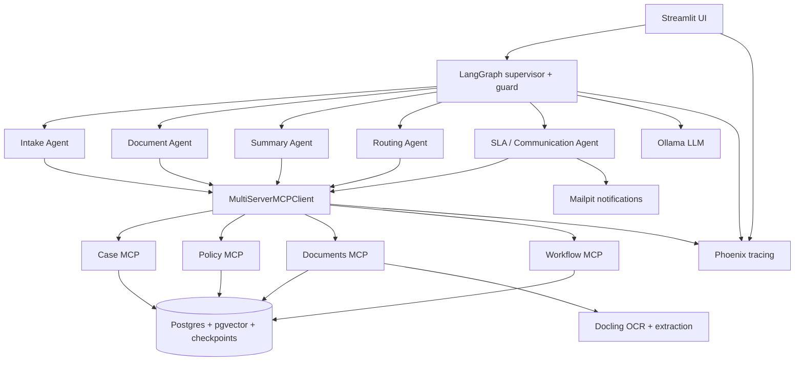

# Intelligent Claims Processing Agent

## Overview
This project automates claims intake, document validation, policy checks, routing, and approval tracking with a LangGraph workflow, MCP tool servers, and a Streamlit UI. It keeps a clear audit trail, prevents unauthorized decisions, and surfaces evaluation and governance checks in one place.

## Architecture



See [docs/architecture.md](docs/architecture.md) for the full architecture reference and component table.

## Quick start with Docker

### Prerequisites
- Docker Engine + Docker Compose v2
- Host Ollama running with `OLLAMA_HOST=0.0.0.0`
- Models available locally: `qwen2.5:3b`, `qwen2.5:7b`, `llama3.1:8b`, and `nomic-embed-text`

### Setup
1. Copy the sample environment file:
   `cp .env.example .env`
2. Start the full stack:
   `docker compose up -d`
3. Open the services:
   - UI: http://localhost:8501
   - Mailpit: http://localhost:8025
   - Phoenix: http://localhost:6006
   - Case MCP: http://localhost:8001/mcp
   - Policy MCP: http://localhost:8002/mcp
   - Documents MCP: http://localhost:8003/mcp
   - Workflow MCP: http://localhost:8004/mcp

Optional profile for machines without host Ollama:
- `docker compose --profile ollama up -d`
- then `docker compose exec ollama ollama pull qwen2.5:3b` and `docker compose exec ollama ollama pull nomic-embed-text`
- set `OLLAMA_BASE_URL=http://ollama:11434`

## Local development without Docker

Use the same Python environment and local services:

```bash
python -m venv .venv
source .venv/bin/activate
python -m pip install -r requirements.txt

# start local Postgres + pgvector, Mailpit, and Phoenix
# then run the local MCP servers
./scripts/run_servers.sh

# start the UI
streamlit run ui/app.py
```

The local workflow intentionally keeps the current non-Docker setup working with the same `.env` configuration and direct `localhost` ports.

## Running a claim end to end

1. Open the Streamlit UI and create or submit a claim.
2. Watch the graph run through intake, document validation, policy/evidence checking, and routing.
3. Review the case summary and generated clause citations.
4. Log in as the approver role before the SLA window closes.
5. Approve or reject the claim from the UI and confirm the Mailpit notification.

Useful CLI checks:

```bash
python -m graph.run_cli --case-id ADJ-1
python -m graph.run_cli --case-id APR-1 --resume
```

## MCP servers

| Server | Primary tools | Resources | Guardrails |
|---|---|---|---|
| Case MCP | `get_case`, `list_cases`, `find_similar_cases`, `register_case`, `attach_document` | `case://{case_id}`, `case://{case_id}/timeline` | Masked claimant email, no approval decisions |
| Policy MCP | `get_policy`, `check_coverage`, `search_policy_wording` | `policy://{policy_number}`, `policy-wording://{product}` | Clause evidence and coverage validation |
| Documents MCP | `list_documents`, `extract_text`, `classify_document`, `extract_fields`, `validate_case_documents` | `document://{case_id}/{doc_id}` | OCR + injection detection + field validation |
| Workflow MCP | `assign_case`, `get_workload`, `request_approval`, `send_notification`, `schedule_sla` | workflow state resources | Recipient allow-list and SLA enforcement |

The no-approve rule is enforced at the tool access layer: decision-making tools are never exposed to the agent runtime, and all approval actions are mediated through the human-in-the-loop workflow.

## Agents and tool access

| Agent | Allowed tools |
|---|---|
| intake | `register_case`, `find_similar_cases`, `attach_document`, `get_policy`, `check_coverage` |
| document | `extract_text`, `classify_document`, `extract_fields`, `validate_case_documents` |
| summary | `save_summary`, `get_case`, `list_documents`, `search_policy_wording` |
| routing | `get_workload`, `assign_case`, `request_approval`, `get_case` |
| sla_comms | `schedule_sla`, `send_notification`, `request_documents` |

The allow-list is defined in [agents/tool_access.py](agents/tool_access.py) and is intentionally strict.

## Governance

The project includes layered governance checks:
- PII minimization and masking in case responses
- Prompt injection detection on uploaded documents
- Append-only audit logging via [common/audit.py](common/audit.py)
- SLA timers and notification flows for missing-document and approval windows
- Governance scripts in [scripts/governance](scripts/governance)

Run the whole gauge set with:

```bash
python -m scripts.governance.run_all
```

## Evaluation

The evaluation pipeline is built around the golden dataset and threshold checks:

```bash
python -m evals.run_eval --name smoke --limit 5
python -m evals.test_gate
python -m evals.report --before baseline --after after
```

The full CI gate is defined in [.github/workflows/ci.yml](.github/workflows/ci.yml).

## Security notes
- This is a lab environment; local password-based auth replaces Keycloak/OIDC in the demo setup.
- Uploaded files are sanitized and validated before they reach the document pipeline.
- Recipient allow-lists prevent email leakage.
- No decision tools are exposed to the autonomous agent runtime.
- `audit_log` is append-only and intentionally not truncatable in a normal demo reset; use the `--hard` reset only for a full fresh volume.

## Limitations and next steps
- Add stronger enterprise auth and single-sign-on integration.
- Expand with Presidio and document-level PII redaction.
- Add OAuth or mTLS for MCP endpoints in a production environment.
- Investigate straight-through processing for low-risk claims.

## Troubleshooting

Common setup issues:
- Module path issues: run from the project root and keep `PYTHONPATH=/app` in Docker images.
- pgvector errors: ensure the Postgres init SQL has run and the `pgvector` extension is enabled.
- Ollama binding: set `OLLAMA_HOST=0.0.0.0` on the host or use the optional `ollama` profile in Compose.
- Docker permissions: ensure your user is in the `docker` group and that Docker Desktop or the Docker daemon is running.

## Related docs
- [docs/architecture.md](docs/architecture.md)
- [docs/demo_script.md](docs/demo_script.md)
- [docs/presentation.md](docs/presentation.md)
