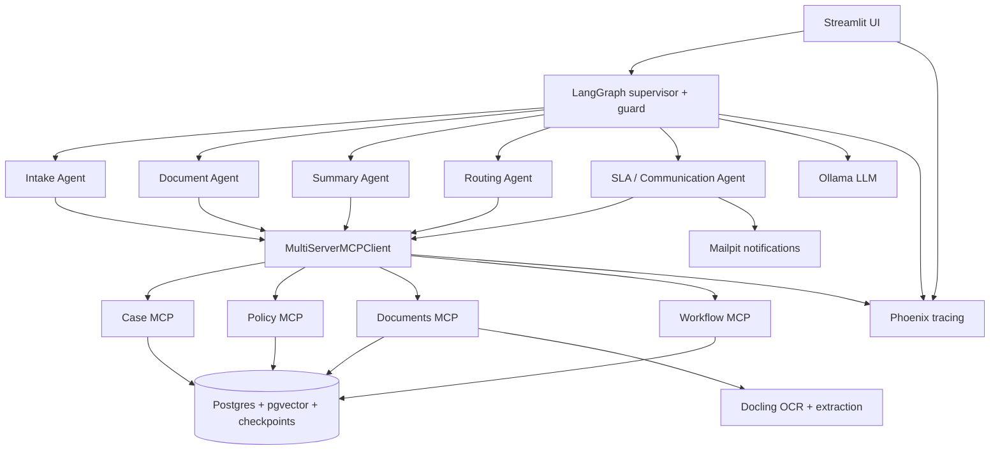

# Architecture



## Component map

| Component | Purpose |
|---|---|
| Streamlit UI | human-in-the-loop case submission, review, approvals, and evaluation dashboards |
| LangGraph supervisor + guard | orchestrates work, applies guardrails, and pauses on approvals or missing documents |
| Five specialist agents | intake, document processing, summarization, routing, and SLA communications |
| MultiServerMCPClient | single tool façade across case, policy, document, and workflow servers |
| Case / Policy / Documents / Workflow MCP | shared tool layer with least-privilege access and isolated responsibilities |
| Postgres + pgvector | durable state, policy data, document metadata, and LangGraph checkpoints |
| Docling | OCR, document extraction, and field validation |
| Ollama | local LLM serving for models used by the workflow |
| Mailpit | inbound/outbound email simulation for decisions and missing-document notices |
| Phoenix | tracing, observability, and evaluation review |

Render the PNG with:

```bash
npx -y @mermaid-js/mermaid-cli -i docs/architecture.md -o docs/architecture.png
```

If `npx` is unavailable in the environment, this step is skipped without failing the project setup.
